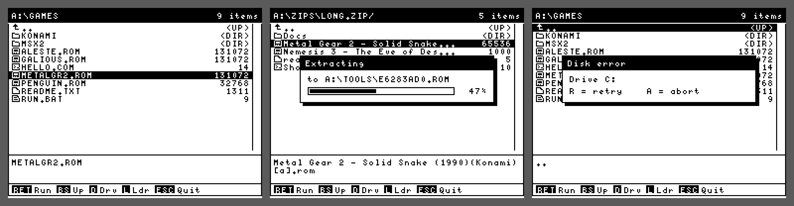
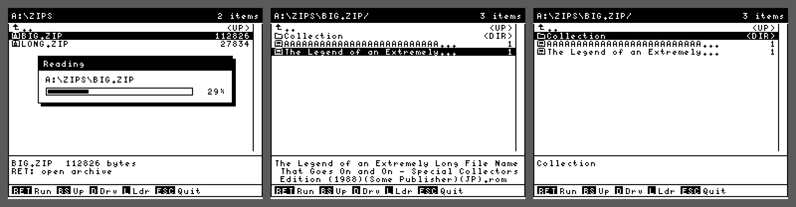
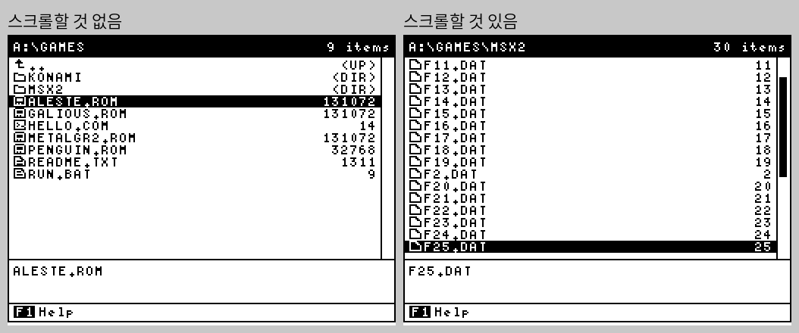
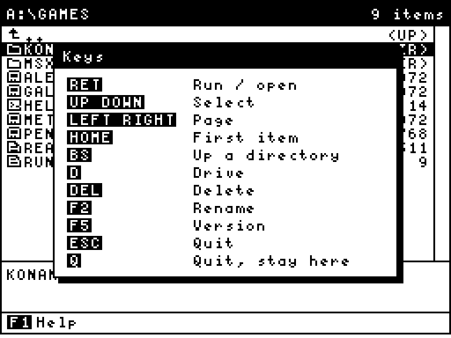
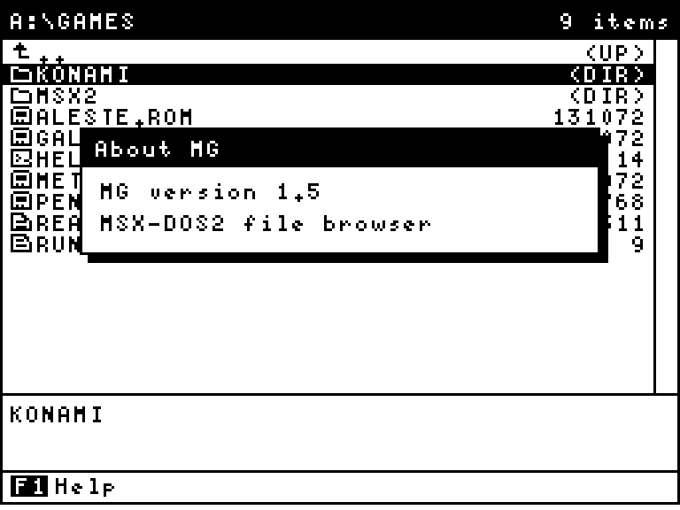
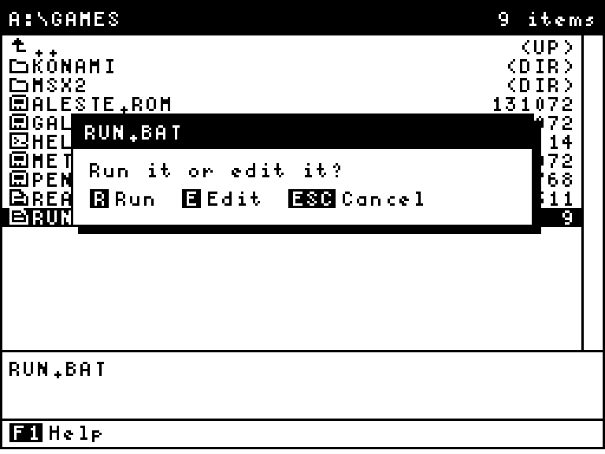
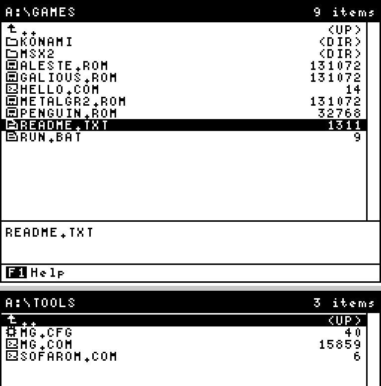
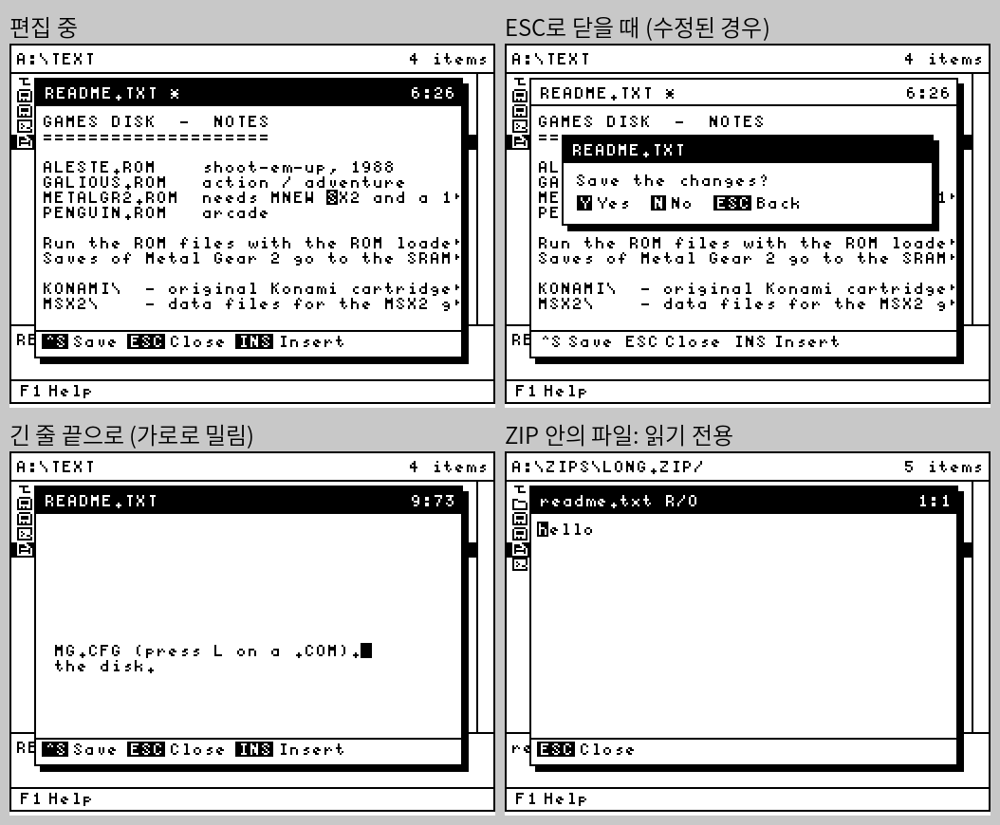

# MG.COM — MSX-DOS2 파일 브라우저 / 런처 (SCREEN 2 그래픽판)

**버전 1.5** (2026-11-21) · 변경 내용은 [CHANGELOG.md](CHANGELOG.md)

MB.COM과 같은 기능을 SCREEN 2(256×192, 흑백 2색) 그래픽 화면으로 보여 주는 별도 프로그램입니다. 목록, ZIP 탐색, ZIP 안 ROM/DSK/COM/BAS/TXT/CFG 실행(CRC32 이름, 이미 풀린 파일 재사용), CFG의 ROM 로더, `.DSK` 런처(`DSKLDR`/`DSKARG`), `.BAS`를 MSX-BASIC으로 실행, `.TXT`/`.CFG`를 내장 편집기 또는 외부 에디터(`EDITOR`/`EDITARG`)로 열기, `STARTDIR`/`TMPDIR` 설정까지 MB와 같은 코드를 씁니다. 실행 파일 크기는 약 14KB입니다(그중 약 3KB는 편집기를 열 때만 읽어 들이는 내장 편집기). 설정 파일은 `MG.CFG`이고 형식은 `MB.CFG`와 같으므로, MB에서 쓰던 파일을 이름만 바꿔 복사해도 됩니다.










왼쪽부터 목록, ZIP 안 압축 해제, 디스크 오류 화면입니다. 시뮬레이터에서 실제 MG.COM을 실행해 VRAM을 그대로 그린 것이고, 글꼴만 실제 기종의 ROM 글꼴 대신 공개 5×8 글꼴을 썼습니다.

## .DSK 런처

`.DSK`를 고르고 RETURN을 누르면 CFG의 `DSKLDR` 프로그램을 `DSKARG`(기본 `%F`) 인자로 실행합니다. ZIP 안의 `.DSK`는 ROM처럼 `TMPDIR`에 CRC32 이름으로 풀어서 실행합니다. 자세한 설정은 MB의 README를 보세요.

```
DSKLDR=A:\TOOLS\EMUFILE.COM
DSKARG=%F
```

## .TXT / .CFG / .INI: 내장 편집기

`.TXT`, `.CFG`, `.INI`를 고르고 RETURN을 누르면(`.BAT`은 E를 고르면) 목록 위에 편집 창이 열립니다(36자 × 14줄).

- **포커스 표시:** 편집 창이 떠 있는 동안 목록의 제목 막대는 흰 바탕에 검은 글씨로, 아래 키 설명 줄은 키캡 반전 없이 흐리게 표시됩니다. 저장 확인 창이 뜨면 편집 창 제목줄과 편집 창 키 설명도 같은 방식으로 바뀝니다.
- **제목줄:** 파일 이름(20자까지), 고친 뒤 저장하지 않았으면 `*`, 오른쪽에 커서 위치(줄:칸).
- **긴 줄:** 접지 않습니다. 창 폭보다 긴 줄은 오른쪽 여백에 ▸ 표시가 붙고, 커서가 창 밖으로 나가면 창 전체가 가로로 밀립니다.

| 키 | 동작 |
|---|---|
| ←→↑↓ | 커서 이동. 줄 끝에서 →는 다음 줄, 줄 처음에서 ←는 윗줄 끝. 위아래로 움직일 때 원래 칸을 기억 |
| SHIFT+↑↓ | 한 페이지(14줄) 위/아래. 끝에 가까우면 창이 비지 않게 마지막 페이지를 채워 보여 줌 |
| HOME / SHIFT+HOME(CLS) | 줄 처음 / 줄 끝 |
| 글자, TAB | 넣기(INS를 누르면 덮어쓰기 ↔ 넣기 전환, 덮어쓰기일 때 커서는 아래 절반) |
| RETURN | 줄 나누기 |
| BS / DEL | 커서 앞 / 커서 위의 글자 지우기(줄 처음에서 BS는 윗줄과 합치기) |
| CTRL+S | 저장 |
| ESC | 닫기. 저장하지 않은 변경이 있으면 "Save the changes?" 창: Y 저장 후 닫기, N 버리고 닫기, ESC 편집으로 돌아가기 |

- **파일 형식:** 줄 끝은 읽을 때 CR LF/LF/CR을 모두 받고, 저장할 때는 원래 파일이 LF만 썼으면 LF, 아니면 CR LF로 씁니다. 파일 끝의 ^Z(1Ah)도 있었으면 다시 붙입니다. TAB은 TAB 그대로 두고 화면에는 한 칸으로 보입니다. 20h–7Eh 밖의 글자는 `?`로 보입니다(2바이트 한글 등은 지원하지 않음).
- **크기:** 편집하는 동안 목록이 쓰던 메모리를 씁니다. 보통 환경(TPA 꼭대기 D500h 안팎)에서 약 31KB(31,750바이트)까지 열 수 있고, 더 크면 "Too big for the editor"를 표시합니다. 닫으면 목록을 다시 읽고 편집한 파일을 선택해 둡니다.
- **MG.CFG:** 저장하면 설정을 바로 다시 읽으므로 MG를 다시 실행하지 않아도 적용됩니다(`TMPDIR`, 로더 등).
- **ZIP 안의 파일:** `TMPDIR`에 풀어서 읽기 전용(`R/O`)으로 보여 줍니다. 이때 키 설명은 `ESC Close`뿐입니다.
- **저장 실패:** 디스크가 가득 차는 등으로 저장하지 못하면 창으로 알리고 편집 화면으로 돌아갑니다(고친 내용은 그대로 남아 있음). 다만 그 사이에 파일은 일부만 쓰였을 수 있습니다.
- **외부 에디터를 쓰려면:** CFG에 `EDITOR`를 적으면 내장 편집기 대신 그 프로그램을 `EDITARG`(기본 `%F`) 인자로 실행합니다(MB와 같음).

```
EDITOR=A:\TOOLS\TED.COM
EDITARG=%F
```

### 내장 편집기의 구조

- 편집기 코드(`mged.asm`, 약 3.7KB, 삭제·이름 바꾸기·`.COM` 배치 만들기도 함께 들어 있음)는 MG.COM 끝에 붙어 있지만 상주하지 않습니다. 텍스트 파일을 열 때 MG가 환경 변수 `PROGRAM`으로 자기 파일을 찾아 그 부분만 목록 메모리로 읽어 들여 실행합니다. 그래서 이 기능들을 넣고도 압축 해제에 필요한 메모리는 1.4와 거의 같습니다. 이 부분을 쓰는 동작(편집, 삭제, 이름 바꾸기)이 끝나면 목록을 다시 읽습니다. MG.COM을 다른 이름으로 바꿔도 동작하지만, 파일 끝이 잘리면 "Cannot load the editor from MG.COM"을 표시합니다.
- 텍스트는 갭 버퍼로 저장합니다(커서 위치의 빈 공간에 글자를 넣고 커서를 옮길 때만 바이트를 옮김). 화면은 바뀐 부분만 다시 그립니다. 커서 이동은 VRAM의 해당 띠를 읽어 커서만 반전하고, 글자를 넣으면 그 줄의 바뀐 칸부터, 줄이 생기거나 없어지면 그 줄부터 아래만 다시 그립니다.

## 키: F1 도움말

맨 아랫줄에는 `F1 Help`만 표시됩니다(F1은 반전된 키캡). F1을 누르면 "Keys" 창이 열려 키와 하는 일을 보여 줍니다. 아무 키나 누르면 닫히고, 그 키는 다른 동작에 쓰이지 않습니다.

| 키 | 동작 |
|---|---|
| RET | 실행 / 열기 |
| UP DOWN | 선택 이동 |
| LEFT RIGHT | 한 페이지 앞 / 뒤 |
| HOME | 첫 항목 |
| BS | 상위 디렉토리 |
| D | 드라이브 변경 |
| DEL | 삭제 (아래 참고) |
| F2 | 이름 바꾸기 (아래 참고) |
| F5 | 버전 창("About MG", `MG version 1.5`) |
| ESC | 종료 (MG를 처음 실행한 디렉토리로) |
| Q | 종료 (지금 디렉토리에 머무름) |

MSX에서 기능 키(F1–F10)를 누르면 BIOS가 정해진 문자열을 키 입력으로 넣습니다(DOS에서는 보통 BASIC이 정해 둔 `color `, `auto `, …, F5는 `run`+RETURN). 그대로 두면 이 글자들이 MG 키로 처리되므로(F5의 RETURN이 선택한 항목을 실행하는 등), MG는 실행 중에만 기능 키 문자열을 비우고 F1·F2·F5에는 MG 전용 코드를 넣습니다. 끝날 때(ESC/Q), 프로그램을 실행하기 전, 오류로 중단될 때 원래 문자열로 되돌립니다. 기능 키 문자열이 비어 있는 환경에서도 F1이 동작하도록 키보드 매트릭스(6행 5비트)도 함께 확인합니다.

## .BAT: 실행할지 편집할지

`.BAT`을 고르고 RETURN을 누르면 파일 이름을 제목으로 한 창에 "Run it or edit it?"과 `R Run` `E Edit` `ESC Cancel`이 나옵니다. R은 지금까지처럼 COMMAND2로 실행하고, E는 `.TXT`처럼 내장 편집기(또는 CFG의 `EDITOR`)로 엽니다. ESC는 아무것도 하지 않고 목록으로 돌아갑니다.

## 설정 파일과 ROM 로더

1.5부터 L 키로 ROM 로더를 등록하는 기능은 없앴습니다. ROM 로더는 `MG.CFG`의 `ROMLDR`/`ROMARG`로만 지정합니다(형식은 MB의 README 참고). `MG.CFG`를 골라 RETURN을 누르면 내장 편집기로 바로 고칠 수 있고, 저장하면 곧바로 적용됩니다. `ROMLDR`이 없으면 `.ROM`을 골랐을 때 "No ROM loader (ROMLDR in the .CFG)"를 표시합니다.

## DEL: 삭제, F2: 이름 바꾸기

- **DEL:** "Delete" 창에 선택한 이름이 나오고 `Y Yes` `N No`를 묻습니다. Y면 지우고 다음 항목(마지막이었으면 앞 항목)을 선택합니다. 빈 디렉토리도 지울 수 있고, 지우지 못하면(읽기 전용, 비어 있지 않은 디렉토리 등) "Cannot delete it"을 표시합니다.
- **F2:** "Rename to" 창에 지금 이름과 커서(`_`)가 나옵니다. BS로 지우고 새 이름을 쳐서 RETURN(ESC는 취소)으로 바꿉니다. 영문은 대문자로 바뀌고, 이름에 쓸 수 없는 문자(`" * + , / : ; < = > ? [ ] \ |`와 공백)는 받지 않으며 12자까지입니다. 같은 이름이 있는 등으로 바꾸지 못하면 "Cannot rename it"을 표시합니다.
- ZIP 안에서는 둘 다 쓸 수 없습니다("Not inside a ZIP").

## .COM: 실행한 뒤 MG로 돌아오기

`.COM`을 실행하면, 끝난 뒤 MG가 다시 시작되어 그 프로그램을 선택해 둡니다. 방법은 MB와 같습니다. `TMPDIR`(없으면 MG.COM 폴더)에 `MGRUN1.BAT`을 만들어 그 경로를 키보드 버퍼에 넣고, COMMAND2가 이를 실행합니다.

```
A:\GAMES\HELLO.COM
A:\TOOLS\MG.COM /R1 A:\GAMES\HELLO.COM A:\
```

- `MGRUN1.BAT`과 `MGRUN2.BAT`을 번갈아 씁니다.
- ZIP 안의 `.COM`은 풀어서 실행하고, 돌아오면 그 ZIP이 선택됩니다.
- `MB.COM`/`MG.COM`은 실행하지 않습니다(`MB.COM / MG.COM: not from here`).
- 배치를 쓸 수 없으면(`PROGRAM` 없음, 경로가 너무 김, `TMPDIR`에 쓸 수 없음) 예전처럼 직접 실행합니다.
- 자세한 내용은 MB의 README "실행 방식"을 보세요.

## .BAS 실행

`.BAS`를 고르고 RETURN을 누르면 텍스트 화면으로 돌아간 뒤 `BASIC 이름.BAS`를 키보드 버퍼에 넣고 끝납니다. COMMAND2가 Disk BASIC으로 넘어가 그 프로그램을 RUN 합니다. DOS로 돌아오려면 BASIC에서 `CALL SYSTEM`. 자세한 내용은 MB의 README를 보세요.

## 화면 구성 (8픽셀 띠 24개)

| 띠 | 내용 |
|---|---|
| 0–1 | 윈도우 제목 표시줄처럼 두꺼운 반전 막대(15픽셀 + 아래 1픽셀 간격). 글자는 세로 가운데. 현재 경로(긴 경로는 끝부분을 `...`과 함께) + 오른쪽에 "N items" (`..` 제외) |
| 2–17 | 목록 16줄: 8×8 아이콘(상위 폴더, 폴더, ZIP, ROM, DSK(플로피), BAS(B), TXT(줄 그은 문서), CFG·INI(톱니바퀴), COM, BAT, 기타 파일), 이름(29자, 넘치면 26자 + `...`), 크기 / `<DIR>` / `<UP>`. 선택 줄은 반전. 오른쪽에 스크롤 막대: 제목 막대부터 구분선까지 이어지는 세로선(x=246) 오른쪽 칸에, 항목이 한 화면보다 많으면 검은 손잡이(x 248–252)가 나타남 |
| 18 | 구분선 (y=148) |
| 19–21 | 선택한 항목의 이름(일반 디렉토리, ZIP 안 모두). 긴 이름은 3줄에 걸쳐 123자까지, 더 길면 3번째 줄 끝을 `...`로 |
| 22–23 | 구분선(y=177), `F1 Help` 하나(F1은 키캡, 글자 y=179로 키캡 y=179–186 안에서 위아래 1픽셀 여백), 아래 테두리(y=189). 위아래 선 사이가 11픽셀로 글자 높이에 맞춰져 있음. 메시지는 이 줄에 약 2초 표시 (MB와 같음) |

- 압축을 풀 때는 목록 위에 그림자 있는 창이 뜨고, 진행 막대와 %가 표시됩니다. 창 제목 막대도 15픽셀로 두껍고, 창 안 글자는 제목 막대 아래로 5픽셀, 왼쪽 테두리에서 8픽셀 떨어져 있습니다. 진행 막대는 8픽셀 띠 하나에 들어 있어서 %가 바뀔 때 그 띠만 다시 그립니다.
- 글자는 8픽셀 띠 경계와 상관없이 원하는 높이에 그릴 수 있습니다(띠마다 잘라서 그림).
- 항목이 64개 이상인 ZIP을 열 때(ZIP 안 폴더를 오갈 때도)는 "Reading" 창에 ZIP 경로와 진행 막대(읽은 항목 비율)를 보여 줍니다. 막대는 32항목마다 갱신합니다. 작은 ZIP은 금방 읽히므로 창을 띄우지 않습니다.
- 글자는 그 기종의 메인 ROM 글꼴(20h–7Eh)을 읽어 6픽셀 간격으로 씁니다. 80h 이상의 글자는 `?`로 보입니다.
- 색: 흰 바탕에 검은 글자 (`INK`/`PAPER` 상수).

## 동작 방식

- **화면 모드:** BIOS CHGMOD를 CALSLT로 호출해 SCREEN 2로 바꿉니다. 이름 테이블은 0–255를 세 번, 색 테이블은 한 값으로 채워서 화면 전체를 1비트 비트맵으로 씁니다.
- **그리기:** 띠 하나(256바이트)를 RAM에서 그린 뒤 VRAM에 한 번에 보냅니다. MSX1 VDP는 SCREEN 2에서 쓰기 간격이 필요해서 바이트마다 32 T-states를 두고, MSX2 이상은 OTIR로 보냅니다. 6픽셀 글자는 회전 명령과 마스크를 글자마다 코드에 써 넣는 방식(자체 수정 코드)으로 두 바이트에 나눠 그립니다.
- **복원:** 끝날 때(ESC/Q), 프로그램을 실행하기 전, DOS가 프로그램을 중단시킬 때(_DEFAB 루틴) 원래 색과 텍스트 모드(40/80컬럼은 DOS 설정대로)로 되돌립니다.
- **디스크 오류:** SCREEN 2에서는 DOS의 "Abort, Retry" 질문이 화면에 보이지 않습니다. 그래서 MG가 디스크 오류 루틴(_DEFER)을 직접 두고 그래픽 창으로 묻습니다. R은 다시 시도, A는 중단(텍스트 화면으로 돌아가 종료)입니다.

## 속도 (시뮬레이터, 3.58MHz Z80 기준)

| 동작 | MG (MSX2) | MG (MSX1) | MB (텍스트) |
|---|---|---|---|
| 커서 이동 | 약 32ms | 약 36ms | 약 7ms |
| 페이지 넘김 | 약 145ms | 약 160ms | 약 55ms |
| 디렉토리 다시 읽기 + 전체 그리기 | 약 205ms | 약 225ms | 약 120ms |
| 항목 702개 ZIP 열기 | 약 1.85초 | | 약 1.3초 |

내장 편집기(MSX2 / MSX1):

| 동작 | MSX2 | MSX1 |
|---|---|---|
| 커서 이동(좌우, 위아래) | 약 30ms | 약 39ms |
| 줄 끝에서 글자 넣기 | 약 30ms | 약 36ms |
| 줄 처음에서 글자 넣기(줄 전체 다시 그림) | 약 62ms | 약 68ms |
| RETURN(아래 줄 전부 다시 그림) | 약 230ms | 약 250ms |
| 페이지 넘김(창 전체) | 약 290ms | 약 320ms |

- 편집 창의 글자 줄은 화면의 8픽셀 띠와 3픽셀 어긋나 있어서(목업에서 정한 위치) 한 줄이 띠 두 개에 걸칩니다. 그래서 창 전체를 그릴 때는 목록보다 느립니다.
- 글자를 치는 동안 미리 친 키는 버리지 않고 차례로 처리합니다. 커서 키만 목록처럼 그리는 동안 눌린 것을 버립니다.

- 시간의 대부분은 6픽셀 글자를 두 바이트에 나눠 그리는 데 쓰입니다. 페이지 넘김 기준으로 글자 그리기가 약 40%, VRAM 전송이 약 17%입니다.
- 더 빠르게 하려면 미리 밀어 둔 글꼴(약 6KB)을 쓰거나 글자 4개를 3바이트로 묶어 그리는 방법이 있습니다. 앞의 방법은 그만큼 메모리 기준이 올라갑니다.
- 압축 해제 시간은 MB와 거의 같습니다(진행 막대를 다시 그리는 시간만 조금 더 듭니다).

## 메모리

- TPA 꼭대기(0006h)가 C900h 이상이어야 시작되고, 압축 해제에는 CD00h 이상이 필요합니다. 압축을 푸는 동안 쓰지 않는 버퍼(경로, 명령 줄, 제목 등 약 0.9KB)를 압축 해제 윈도 앞쪽에 두어, 상주 코드가 늘어난 만큼을 메웠습니다. 내장 편집기는 목록 메모리를 쓰므로 따로 더 필요하지 않습니다. 보통 환경(약 53K TPA, D500h 안팎)이면 충분합니다.
- 모자라면 화면 모드를 바꾸기 전에 메시지를 내고 끝납니다.

## 빌드 / 테스트

```
python3 build.py     # pyz80 필요 (pip install pyz80)
#  1. mg.asm  -> build/mg_main.bin (+ 기호 표 build/mg.sym)
#  2. 기호 표 -> build/mgsyms.inc (편집기가 MG의 루틴과 변수를 쓰도록)
#  3. mged.asm -> build/mged.bin (목록 메모리 WIN에서 실행되도록 조립)
#  4. MG.COM = mg_main.bin + mged.bin, 크기와 메모리 조건 확인

cd test
python3 run_tests.py      # 166개 항목(build.py 먼저 실행): 화면(OCR로 글자 읽기), 이동, ZIP, 압축 해제 창, 실행, 종료, 디스크 오류, MSX1, 내장 편집기(편집·저장·줄 끝 형식·저장 확인·ZIP 읽기 전용·디스크 가득 참·속도), F1 도움말, 삭제, 이름 바꾸기, `.COM` 배치와 다시 시작, `.BAT` 실행/편집 선택, `.INI`
python3 test_inflate.py   # 압축 해제 26가지, 원본과 바이트 단위 비교
```

시뮬레이터(`test/msxsim.py`)는 MB 것에 다음을 더했습니다.
- CALSLT/CHGMOD와 ROM 글꼴
- SCREEN 2 VRAM을 PNG로 그리기와 글자 읽기(OCR)
- 디스크 오류(MG의 _DEFER 루틴 호출, 다시 시도/중단)
- 키보드 매트릭스(F1, SHIFT), 키 사이 T-state 시간(속도 측정), 명령 줄 인자, `_RENAME`, 빈 디렉토리 삭제

## 제한 사항

- **실기와 openMSX에서는 아직 테스트하지 않았습니다.** 특히 아래 세 가지는 실기에서 확인이 필요합니다.
  - CHGMOD 전환 후 DOS로 돌아왔을 때 화면 상태
  - MSX1 VDP 쓰기 간격
  - 디스크 오류 루틴의 동작
- 콘솔 대체 모드가 없습니다. SCREEN 2를 쓸 수 없는 환경은 고려하지 않았습니다.
- 80컬럼(MODE 80) 사용자도 MG 화면은 42글자 폭입니다. 긴 이름은 아래 정보 3줄에서 123자까지 볼 수 있습니다.

## 버전 관리

- 현재 버전은 `VERSION` 파일과 소스 머리말에 적혀 있고, 실행 파일 안에도 `MG version 1.5` 문자열로 들어 있습니다.
- 소스는 git 저장소로 관리하며 릴리스마다 `v1.0` 같은 태그를 붙입니다. 버전별 변경 내용은 `CHANGELOG.md`에 적습니다.
- 배포 파일 이름에는 버전이 붙습니다(`MG_v1.5.zip`).
