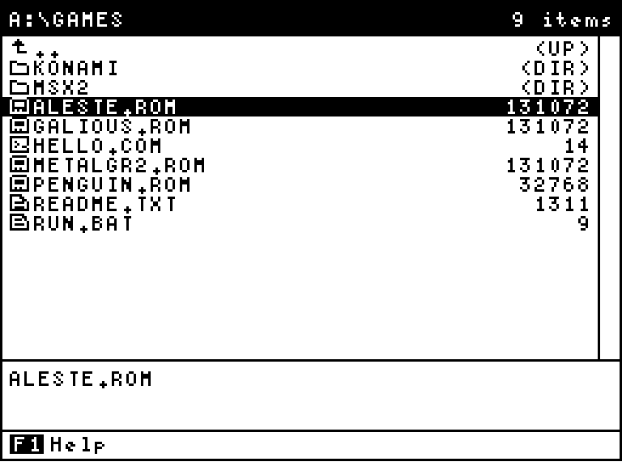
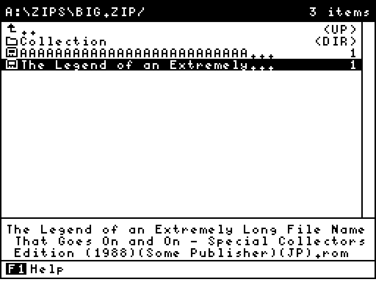
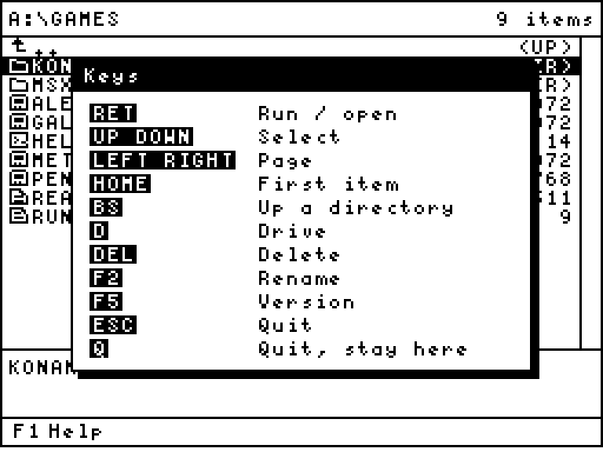
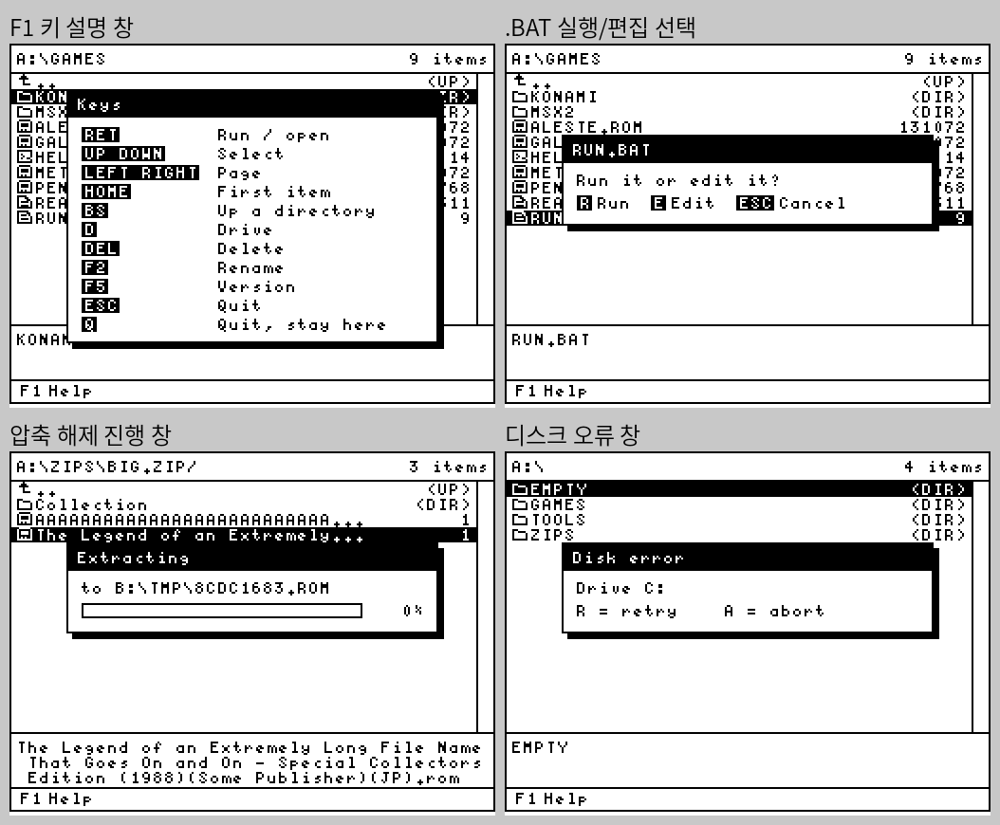

# MG — MSX-DOS2 파일 브라우저 / 런처 (SCREEN 2 그래픽)

**버전 1.5** · 변경 내역은 [CHANGELOG.md](CHANGELOG.md)

MG는 MSX-DOS2(또는 Nextor)에서 동작하는 파일 브라우저이자 런처입니다. SCREEN 2(256×192, 흑백 2색) 그래픽 화면에 디렉토리와 파일을 목록으로 보여 주고, 고른 파일을 종류에 맞게 실행합니다. ZIP 파일 안을 디렉토리처럼 둘러보고, 그 안의 ROM·디스크 이미지·프로그램을 바로 풀어서 실행할 수 있습니다. 텍스트 파일을 고칠 수 있는 편집기도 들어 있습니다.



## 주요 기능

- **목록:** 디렉토리를 먼저, 그다음 파일을 이름순으로 보여 줍니다. 파일 종류마다 아이콘이 붙고, 오른쪽에 크기와 스크롤 막대가 있습니다.
- **실행:** `.COM`(끝나면 MG로 돌아옴), `.BAT`, `.BAS`(MSX-BASIC), `.ROM`(지정한 ROM 로더로), `.DSK`(지정한 디스크 이미지 런처로)
- **ZIP:** 압축 파일 안을 디렉토리처럼 둘러보고(긴 이름 그대로), 안의 파일을 풀어서 실행합니다. Deflate 압축 해제기를 Z80으로 직접 구현했습니다.
- **내장 편집기:** `.TXT`, `.CFG`, `.INI`(그리고 고르면 `.BAT`)를 창에서 열어 고치고 저장합니다.
- **파일 관리:** DEL로 삭제, F2로 이름 바꾸기
- **창 방식 화면:** 압축 해제 진행 창, 디스크 오류 창, 키 설명 창 등. 창이 뜨면 목록 쪽은 비활성(포커스 이동)으로 표시됩니다.

| ZIP 안 (긴 이름은 아래 3줄에) | F1 키 설명 |
|---|---|
|  |  |



## 요구 사항

- MSX, MSX2, MSX2+, turbo R. SCREEN 2를 쓰므로 MSX1 VDP에서도 동작하도록 만들었습니다.
- MSX-DOS2 또는 Nextor. MSX-DOS1에서는 "MG requires MSX-DOS2 (or Nextor)."를 표시하고 끝납니다.
- TPA 꼭대기(0006h)가 C900h 이상이어야 시작하고, ZIP 안의 파일을 풀 때는 CD00h 이상이 필요합니다. 보통의 DOS2 환경(D500h 안팎)이면 충분합니다. 모자라면 화면을 바꾸기 전에 메시지를 내고 끝납니다.

## 설치와 실행

1. `MG.COM`을 원하는 폴더(예: `A:\TOOLS`)에 복사합니다. PATH에 있는 폴더라면 어디서든 `MG`로 실행할 수 있습니다.
2. 필요하면 같은 폴더에 설정 파일 `MG.CFG`를 만듭니다(아래 "설정 파일" 참고). 설정 파일이 없어도 목록, ZIP, 편집기, `.COM`/`.BAT`/`.BAS` 실행은 동작합니다.
3. `MG`를 입력합니다.

설정 파일은 MG.COM과 같은 폴더에서 같은 이름으로 찾습니다(환경 변수 `PROGRAM`을 이용). 그래서 MG.COM을 `BROWSE.COM`으로 바꾸면 `BROWSE.CFG`를 읽습니다. `PROGRAM`이 없는 환경에서는 현재 디렉토리의 `MG.CFG`를 읽습니다.

## 화면

| 위치 | 내용 |
|---|---|
| 맨 위 | 제목 표시줄: 현재 경로와 항목 수(`..` 제외) |
| 가운데 | 목록 16줄: 아이콘, 이름(29자, 넘치면 `...`), 크기 / `<DIR>` / `<UP>`. 선택한 줄은 반전. 오른쪽 스크롤 막대 |
| 아래 3줄 | 선택한 항목의 전체 이름(ZIP 안의 긴 이름도 123자까지) |
| 맨 아래 | `F1 Help`. 메시지는 이 줄에 약 2초 동안 표시됩니다 |

아이콘: 상위 폴더, 폴더, ZIP, ROM, DSK(플로피), BAS, TXT, CFG·INI(톱니바퀴), COM, BAT, 기타 파일

다른 창(키 설명, 버전, 질문, 압축 해제 진행, 디스크 오류, 편집기)이 뜨면 제목 표시줄은 흰 바탕에 검은 글씨로, 맨 아랫줄은 흐리게 바뀌어 포커스가 그 창으로 옮겨진 것처럼 보입니다.

## 키

| 키 | 동작 |
|---|---|
| ↑ ↓ | 선택 이동 |
| ← → | 한 페이지 앞 / 뒤 |
| HOME | 첫 항목 |
| RETURN | 디렉토리·ZIP이면 들어가고, 파일이면 종류에 따라 실행하거나 엶(아래 표) |
| BS | 상위 디렉토리(ZIP 안에서는 상위 폴더, ZIP 맨 위에서는 ZIP 밖으로) |
| D | 드라이브 변경(A–H 입력) |
| DEL | 선택한 파일 또는 빈 디렉토리 삭제(Y/N 확인) |
| F2 | 이름 바꾸기 |
| F1 | 키 설명 창 |
| F5 | 버전 창 |
| ESC | 끝내기(MG를 실행했던 디렉토리로 돌아감) |
| Q | 끝내기(지금 디렉토리에 머무름) |

MSX에서 기능 키를 누르면 BIOS가 정해진 문자열(DOS에서는 보통 `color `, `auto `, … , F5는 `run`+RETURN)을 키 입력으로 넣습니다. MG는 실행 중에만 기능 키 문자열을 비우고 F1·F2·F5에 자기 코드를 넣습니다. 그리고 끝날 때, 프로그램을 실행하기 전, 오류로 중단될 때 원래 문자열로 되돌립니다.

## 파일 종류별 동작 (RETURN)

| 파일 | 동작 |
|---|---|
| `.COM` | 실행합니다. 끝나면 MG가 다시 시작되어 그 프로그램을 선택해 둡니다(아래 참고) |
| `.BAT` | "Run it or edit it?" 창: R은 COMMAND2로 실행, E는 편집기로 열기, ESC는 취소 |
| `.BAS` | `BASIC 이름.BAS`로 MSX-BASIC에서 실행합니다. DOS로 돌아오려면 BASIC에서 `CALL SYSTEM` |
| `.ROM` | 설정 파일의 ROM 로더(`ROMLDR`)를 `ROMARG` 인자로 실행 |
| `.DSK` | 설정 파일의 디스크 이미지 런처(`DSKLDR`)를 `DSKARG` 인자로 실행 |
| `.TXT` `.CFG` `.INI` | 내장 편집기(설정 파일에 `EDITOR`가 있으면 그 프로그램) |
| `.ZIP` | 그 안으로 들어감 |

`.BAT`, `.BAS`는 실행할 명령을 키보드 버퍼에 넣고 MG가 끝나면, 다시 올라온 COMMAND2가 그 명령을 실행하는 방식입니다. `.ROM`·`.DSK`는 로더를 직접 불러 실행합니다. 이 경우들은 실행이 끝나도 MG로 돌아오지 않습니다.

## 설정 파일 (MG.CFG)

텍스트 파일입니다. MG에서 `MG.CFG`를 골라 RETURN을 누르면 내장 편집기로 바로 고칠 수 있고, 저장하면 곧바로 다시 읽어 적용합니다. 모든 줄은 선택 사항입니다.

```
ROMLDR=A:\TOOLS\SOFAROM.COM
ROMARG=%F
DSKLDR=A:\TOOLS\EMUFILE.COM
DSKARG=%F
EDITOR=A:\TOOLS\TED.COM
EDITARG=%F
TMPDIR=H:\
STARTDIR=A:\GAMES
```

| 키 | 뜻 |
|---|---|
| `ROMLDR` | `.ROM`을 실행할 ROM 로더 프로그램(.COM). 없으면 "No ROM loader (ROMLDR in the .CFG)" |
| `ROMARG` | ROM 로더에 넘길 인자. 기본 `%F` |
| `DSKLDR` | `.DSK`를 열 디스크 이미지 런처. 없으면 "No DSK launcher (DSKLDR in the .CFG)" |
| `DSKARG` | 런처 인자. 기본 `%F` |
| `EDITOR` | `.TXT`/`.CFG`/`.INI`/`.BAT`(편집)에 내장 편집기 대신 쓸 외부 에디터 |
| `EDITARG` | 에디터 인자. 기본 `%F` |
| `TMPDIR` | ZIP에서 푼 파일과 `.COM` 실행용 배치 파일을 둘 폴더. 없으면 MG.COM이 있는 폴더. RAM 디스크(예: `H:\`)를 쓰면 빠르고 디스크도 닳지 않습니다 |
| `STARTDIR` | MG가 이 디렉토리에서 시작합니다(`A:\GAMES` 또는 `B:`처럼 드라이브만). 없는 디렉토리면 실행한 곳에서 시작하고 "STARTDIR not found"를 표시. ESC로 끝내면 처음 실행한 디렉토리로 돌아갑니다 |

인자(`ROMARG`, `DSKARG`, `EDITARG`)에 쓰는 기호는 다음과 같습니다.

| 기호 | 바뀌는 값 |
|---|---|
| `%F` | 파일의 전체 경로(예: `A:\GAMES\GALIOUS.ROM`) |
| `%N` | 파일 이름만(예: `GALIOUS.ROM`). 실행할 때 현재 디렉토리가 그 파일이 있는 폴더라서 이름만으로도 찾아집니다 |
| `%%` | `%` 문자 |

예를 들어 `ROMARG=%F /S`처럼 로더의 옵션을 덧붙일 수 있습니다. 받는 옵션은 로더마다 다르니 사용하는 로더의 문서를 확인하세요.

## ZIP 파일

- **둘러보기:** 중앙 디렉토리를 읽어 목록을 만들기 때문에 압축 방식과 상관없이 볼 수 있습니다. ZIP 안의 경로로 폴더를 만들고, 이름은 저장된 그대로(대소문자, 공백, 긴 이름) 보여 줍니다. 항목이 64개 이상이면 "Reading" 창에 진행 막대를 보여 줍니다.
- **풀어서 실행:** ZIP 안의 `.ROM`, `.DSK`, `.COM`, `.BAS`를 고르면 "Extracting" 창에 진행 막대를 보이며 `TMPDIR`에 풀고 실행합니다. `.TXT`, `.CFG`, `.INI`는 풀어서 편집기로 엽니다. 내장 편집기에서는 읽기 전용(`R/O`)입니다.
- **임시 파일 이름:** ZIP 목록의 CRC32를 16진수 8자리로 쓰고 확장자는 그대로 둡니다(예: `770D7D98.ROM`). 그래서 이름이 비슷한 게임끼리도 겹치지 않습니다.
- **재사용:** `TMPDIR`에 같은 이름·같은 크기의 파일이 있으면 다시 풀지 않고 그것을 씁니다. 두 번째 실행부터는 해제 시간이 들지 않습니다.
- **지원 방식:** 저장(Stored)과 Deflate. 풀린 크기가 다르거나 데이터가 깨져 있으면 "ZIP data error"를 표시하고, 덜 풀린 파일은 지웁니다.
- **속도(3.58MHz, 디스크 시간 제외):** 32KB ROM 약 4초, 128KB 메가롬 약 15초. 저장 방식이거나 turbo R이면 훨씬 빠릅니다.
- ZIP 안에서는 삭제와 이름 바꾸기를 할 수 없습니다.

## .COM 실행 후 MG로 돌아오기

`.COM`을 실행하면 MG는 `TMPDIR`에 다음과 같은 배치 파일 `MGRUN1.BAT`을 만듭니다. 그리고 그 경로를 키보드 버퍼에 넣고 끝납니다.

```
A:\GAMES\HELLO.COM
A:\TOOLS\MG.COM /R1 A:\GAMES\HELLO.COM A:\
```

COMMAND2가 이 배치를 실행하므로 프로그램이 먼저 실행되고, 끝나면 MG가 다시 시작됩니다. 다시 시작된 MG는 그 프로그램이 있던 디렉토리에서 그 파일을 선택해 두고(ZIP에서 꺼낸 프로그램이면 그 ZIP을 선택), ESC를 누르면 처음 실행했던 디렉토리로 돌아갑니다.

- `MGRUN1.BAT`과 `MGRUN2.BAT`을 번갈아 씁니다. COMMAND2는 배치 파일을 한 줄씩 다시 읽기 때문에, 지금 MG를 실행 중인 배치 파일을 덮어쓰지 않기 위해서입니다.
- `MG.COM` 자신은 이렇게 실행하지 않습니다("MG cannot run itself").
- 다음 경우에는 예전 방식처럼 MG가 프로그램을 직접 실행하고, 끝나면 DOS 프롬프트로 돌아갑니다: `PROGRAM` 환경 변수가 없을 때, 배치 파일 경로가 32자를 넘을 때(키보드 버퍼 한계), 명령 줄이 너무 길 때, `TMPDIR`에 쓸 수 없을 때.
- MG를 `AUTOEXEC.BAT` 같은 배치 파일의 중간 줄에서 실행하면, MG가 끝난 뒤 그 배치의 다음 줄이 먼저 실행됩니다. MG는 배치 파일의 마지막 줄에서 실행하는 것이 좋습니다(`.BAT`, `.BAS` 실행도 마찬가지).

## 내장 편집기

`.TXT`, `.CFG`, `.INI`를 고르면(설정 파일에 `EDITOR`가 없을 때) 목록 위에 편집 창(36자 × 14줄)이 열립니다. 제목줄에는 파일 이름, 고친 뒤 저장하지 않았으면 `*`, 오른쪽에 커서 위치(줄:칸)가 나옵니다.


| 키 | 동작 |
|---|---|
| ← → ↑ ↓ | 커서 이동(위아래로 움직일 때 원래 칸을 기억) |
| SHIFT + ↑ ↓ | 한 페이지(14줄) 위 / 아래 |
| HOME / SHIFT+HOME | 줄 처음 / 줄 끝 |
| 글자, TAB | 넣기. INS로 덮어쓰기와 넣기를 바꿈(덮어쓰기일 때 커서는 아래 절반) |
| RETURN | 줄 나누기 |
| BS / DEL | 커서 앞 / 커서 위의 글자 지우기(줄 처음에서 BS는 윗줄과 합치기) |
| CTRL+S | 저장 |
| ESC | 닫기. 저장하지 않은 변경이 있으면 "Save the changes?": Y 저장 후 닫기, N 버리고 닫기, ESC 편집으로 돌아가기 |

- 창 폭보다 긴 줄은 접지 않고, 오른쪽 여백에 ▸ 표시가 붙습니다. 커서가 창 밖으로 나가면 창 전체가 가로로 밀립니다.
- 줄 끝은 CR LF / LF / CR을 모두 읽고, 저장할 때는 원래 파일이 LF만 썼으면 LF, 아니면 CR LF로 씁니다. 파일 끝의 ^Z(1Ah)도 있었으면 다시 붙입니다.
- 편집하는 동안 목록 메모리를 쓰므로 보통 환경에서 약 31KB까지 열 수 있습니다. 더 크면 "Too big for the editor"를 표시합니다. 닫으면 목록을 다시 읽고 그 파일을 선택해 둡니다.
- 저장하지 못하면(디스크가 가득 참 등) 창으로 알리고 편집 화면으로 돌아갑니다. 고친 내용은 남아 있지만, 그 사이에 파일은 일부만 쓰였을 수 있습니다.
- 20h–7Eh 밖의 글자는 `?`로 보입니다. 2바이트 문자는 지원하지 않습니다.
- 편집기 코드는 MG.COM 끝에 붙어 있다가, 열 때만 메모리로 읽어 들입니다. 그래서 MG.COM 끝이 잘린 파일이면 "Cannot load the editor from MG.COM"을 표시합니다.

## 삭제와 이름 바꾸기

- **DEL:** 선택한 이름을 보여 주고 Y/N을 묻습니다. Y면 지우고 다음 항목(마지막이었으면 앞 항목)을 선택합니다. 빈 디렉토리도 지울 수 있습니다. 지우지 못하면 "Cannot delete it"을 표시합니다.
- **F2:** 지금 이름이 입력 창에 나옵니다. BS로 지우고 새 이름을 쳐서 RETURN으로 바꾸고, ESC는 취소입니다. 영문은 대문자로 바뀌고, 이름에 쓸 수 없는 문자(`" * + , / : ; < = > ? [ ] \ |`, 공백)는 받지 않으며, 12자까지 입력됩니다. 바꾸지 못하면 "Cannot rename it"을 표시합니다.

## 디스크 오류

SCREEN 2에서는 DOS의 "Abort, Retry" 질문이 보이지 않으므로 MG가 직접 "Disk error" 창으로 묻습니다. R은 다시 시도하고, A는 중단합니다(텍스트 화면으로 돌아가 끝남). MG가 어떻게 끝나든(정상 종료, 프로그램 실행, 중단) 원래 색과 텍스트 화면, 기능 키 문자열을 되돌립니다.

## 빌드

[pyz80](https://pypi.org/project/pyz80/) 어셈블러와 Python 3가 필요합니다.

```
pip install pyz80
python3 build.py
```

`build.py`는 다음 순서로 MG.COM을 만듭니다.

1. `mg.asm`을 조립합니다(프로그램 본체와 기호 표).
2. 기호 표로 `build/mgsyms.inc`를 만듭니다.
3. `mged.asm`을 조립합니다. 내장 편집기, 삭제, 이름 바꾸기, `.COM` 배치 만들기가 들어 있고, MG의 목록 메모리에서 실행되도록 조립합니다.
4. 두 결과를 이어 붙여 MG.COM을 만들고, 크기와 메모리 조건을 확인합니다.

## 파일 구성

| 파일 | 내용 |
|---|---|
| `MG.COM` | 실행 파일 |
| `mg.asm` | 본체 소스(Z80 어셈블리) |
| `mged.asm` | 필요할 때만 읽어 들이는 부분(편집기 등)의 소스 |
| `build.py` | 빌드 스크립트 |
| `CHANGELOG.md` | 변경 내역 |
| `VERSION` | 버전 번호 |
| `docs/` | README의 화면 그림(시뮬레이터에서 MG.COM을 실행해 찍은 것. 글꼴은 실제 기종의 ROM 글꼴 대신 비슷한 글꼴) |

## 제한 사항

- 한 디렉토리(또는 ZIP 안 폴더)에 640개 항목까지 보여 줍니다.
- ZIP64 형식과, 끝에 1KB가 넘는 주석이 붙은 ZIP은 지원하지 않습니다.
- ZIP 항목의 CRC32는 검사하지 않습니다(크기와 압축 데이터 구조만 검사). 풀어 놓은 파일의 재사용도 이름과 크기로만 판단합니다.
- ZIP 안의 UTF-8 이름(한글 등)은 MSX 문자로 찍혀 알아볼 수 없는 글자로 보입니다.
- 풀어 놓은 파일은 재사용하려고 `TMPDIR`에 남겨 둡니다. 공간이 필요하면 지워도 됩니다(다음에 다시 풉니다).
- 화면은 SCREEN 2 전용입니다. 80컬럼 환경에서도 MG 화면은 42글자 폭입니다.
